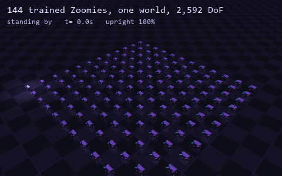
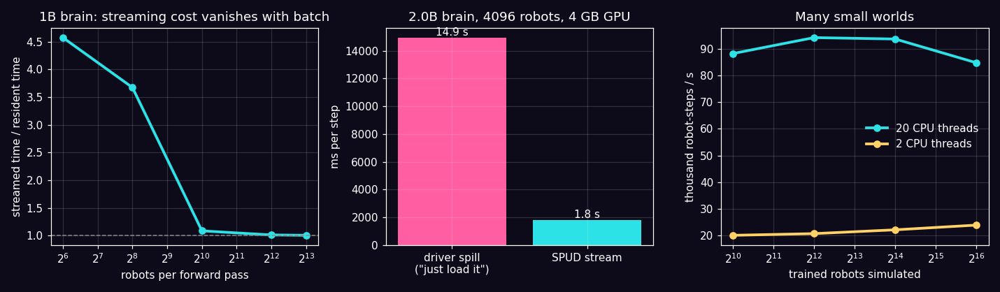
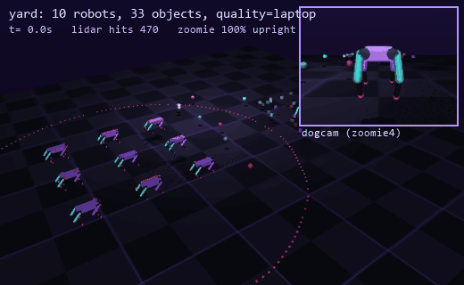
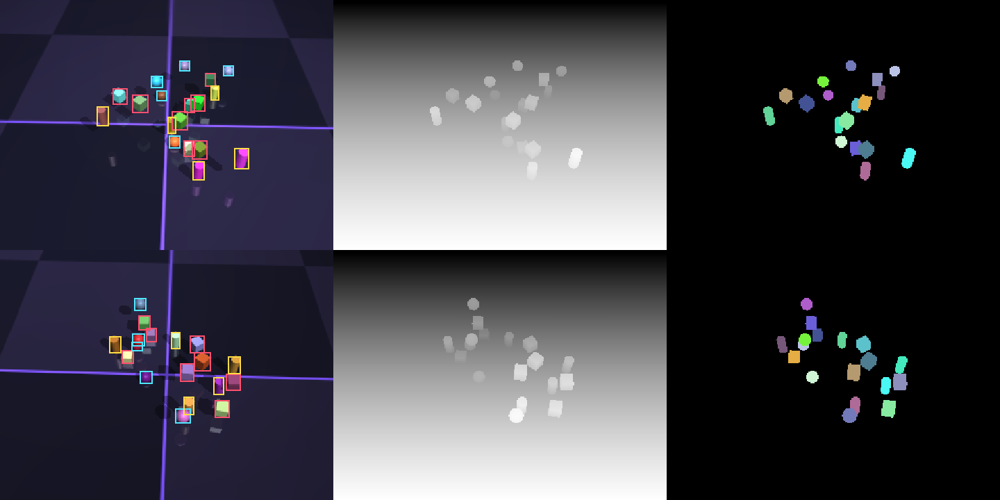
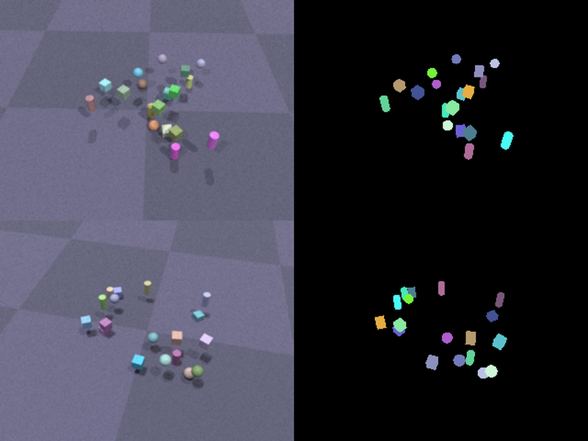

# SPUD

[](https://github.com/nonberw/spud/actions/workflows/ci.yml)

> Run big robot simulations and models too big for your GPU, on a potato.
> Tested on a laptop with a 4 GB RTX 3050 Ti. Then on a pretend laptop with 1 GB of VRAM, 4 GB of RAM and 2 CPU cores, because "works on my machine" isn't good enough.



*144 trained [Zoomies](https://github.com/nonberw/zoomies) in one MuJoCo world (2,592 degrees of freedom), all driven by one batched policy, simulated faster than real time on a laptop CPU.*

---

## TL;DR

- **Models bigger than your GPU.** A 2-billion-parameter network (3.8 GB) runs on a 4 GB card in **about 0.5-0.65 GB of VRAM**, **7-8x faster** than letting the driver spill it into system RAM (7.4x and 8.2x in two runs), and **bit-identical** to a normal run.
- **Streaming is almost free when you control a lot of robots.** Each layer is loaded once per step and shared by the whole batch. At 1024+ robots per pass, streaming costs **1-9%** over a fully resident model, and **about 1%** over pure compute on the 2B model.
- **Huge simulations.** **65,536 trained robots** walking at once at **~85k robot-steps/s**, in **0.1 GB** of RAM for the simulator, on all CPU cores (~24k on 2 cores). One big world with **1,024 robots** (18,432 DoF) works too, and everyone stays on their feet.
- **Even weaker hardware.** `--vram 1 --ram 4 --threads 2` makes your machine pretend to be a potato. With those limits, a **3.15B-param** brain drives **16,384** robots in **0.69 GB** of VRAM, streaming its weights from disk.
- **`spud plan` tells you before you start**: will it fit, in which mode, how fast. Its predictions landed within **-2% to +7%** of measured runs here.
- **Isaac-lite (v0.2-0.3):** GPU physics (**463k robot-steps/s**, 5x the CPU), sensor noise, photoreal path-traced frames, a ROS 2 bridge, and scenes from one YAML file (robots, your own URDF/MJCF, objects, rough terrain, stairs, lights), sensors (RGB/depth/segmentation cameras, lidar, IMU, contacts), a domain-randomized dataset generator with COCO labels, an interactive viewer, and quality presets picked from your hardware. A yard with 10 robots, 33 objects and 5 sensors runs at **11x real time**.

## Why

Robot learning wants two things that hate weak hardware: big models (foundation policies, VLAs) and big simulations (thousands of robots). The usual answer is "rent an A100". SPUD's answer is to notice that the two fit together. If one model controls thousands of robots, every weight you move to the GPU gets used thousands of times. So you can keep the model in RAM (or on disk), stream it through a tiny GPU one layer at a time, and the copies hide behind the math.

## How it works

### Layer streaming (`spud/stream.py`)

```
  RAM (pinned) or disk                   GPU (tiny)
  [block 0][block 1]...[block N]   -->   slot A: block i     (computing)
         copy stream, async               slot B: block i+1  (loading)
```

- Every block's weights are packed into **one contiguous buffer per dtype** in page-locked RAM, so loading a block is a single DMA copy instead of hundreds of small ones.
- The GPU keeps only 2 slots. Copies run on a **separate CUDA stream**, and CUDA events do the bookkeeping: compute waits for "slot loaded", and the copy waits for "slot no longer in use". Block `i+1` loads while block `i` computes.
- **Disk store** for models bigger than RAM: the next block is read from disk on the CPU while the GPU is busy, then copied up.
- **Micro-batches**: if even the activations don't fit, the batch is split *inside* each block, so every weight copy is still shared by the whole batch.
- **Bit-exact**: the tests check that streamed output equals a resident run exactly, for every store and slot count. With micro-batching, it equals a resident run on the same chunks. Different chunk sizes make cuBLAS pick different kernels, so that's the honest comparison.

The design is inspired by [Soup](https://github.com/MakazhanAlpamys/Soup), which fine-tunes 8B LLMs on 4 GB laptop GPUs with layer streaming. SPUD is an independent, inference-only implementation for any stack of same-shaped blocks, pointed at robots. See [NOTICE](NOTICE).

### The planner (`spud/plan.py`)

Step time = max(weight transfer, compute), because the two overlap.

- **Transfer** is model size divided by the measured host-to-GPU bandwidth (12 GiB/s here).
- **Compute** is measured by running one real block at your batch size. This matters: matmul efficiency depends on the shapes. On this laptop it was 12.7 TFLOPS at width 1856 and 9.2 TFLOPS at width 2304.
- **Activation memory** is measured, not guessed: 13-16.5x (tokens x width x 2 bytes) per block, budgeted as 17x. The first version guessed 10x and promised a potato run would fit in 0.85 GB. It OOM'd at 1 GB, we measured, and fixed it. The same run now peaks at 0.69 GB.
- **RAM safety rules** come from Soup: the pinned store stays under 70% of free RAM and 55% of total RAM, because pinned memory can't be paged out.

| Prediction vs. reality (laptop) | Predicted | Measured |
|---|---|---|
| 1B brain, 64 robots | 154 ms | 157 ms |
| 1B brain, 1,024 robots | 180 ms | 169 ms |
| 1B brain, 8,192 robots | 1,254 ms | 1,209 ms |
| 2B brain, 4,096 robots | 1,794 ms | 1,830 ms |

### Simulation (`spud/mass.py`, `spud/swarm.py`)

- **Many small worlds**: N independent robots as rows of one state array, stepped by MuJoCo's C thread pool (`mujoco.rollout`), chunked to a RAM budget, with atomic checkpoints, so `--resume` survives a crash. If your robots don't touch each other, this is the fast way.
- **One big world**: N robots in one MuJoCo scene via `MjSpec.attach`. Slower, because a single world steps on a single core, but it's what you want when robots *do* interact (and it makes better GIFs).

## Results (RTX 3050 Ti Laptop 4 GB, 20 threads, 16 GB RAM)

**Streaming a 1B-param brain** (1.85 GB of weights), resident vs. streamed:

| Robots per pass | 64 | 256 | 1,024 | 4,096 | 8,192 |
|---|---|---|---|---|---|
| Resident | 35 ms | 44 ms | 157 ms | 629 ms | 1,201 ms |
| Streamed | 160 ms | 162 ms | 171 ms | 639 ms | 1,211 ms |
| Streaming overhead | 4.6x | 3.7x | **1.09x** | **1.01x** | **1.01x** |
| Bit-identical to resident | yes | yes | yes | yes | yes |

Streamed VRAM is 0.24 GB at 256 robots and 0.71 GB at 8,192 (the activations grow, the weights don't). Resident needs 1.9 GB.

**A 2B brain on a 4 GB card**, 4,096 robots per step:

| | Time per step | VRAM |
|---|---|---|
| "Just load it" (the Windows driver spills to system RAM) | 14,917 ms | all of it |
| **SPUD stream** | **1,819 ms** | **0.53 GB** |
| Pure compute, no copies at all (lower bound, separate run) | 1,807 ms | |

A first, manual run gave 13,631 ms vs. 1,830 ms (7.4x). Laptop clocks move around, so expect a few % of noise.

**Trained robots, many small worlds**:

| Robots | 20 CPU threads | 2 CPU threads | Simulator RAM | Upright |
|---|---|---|---|---|
| 1,024 | 88,236 | 20,105 | <0.01 GB | 100% |
| 4,096 | 94,204 | 20,740 | 0.01 GB | 100% |
| 16,384 | 93,672 | 22,164 | 0.03 GB | 100% |
| **65,536** | **84,780** | 23,932 | **0.10 GB** | **100%** |

Robot-steps per second, including the trained policy. These are from `scripts/benchmark.py`; an earlier manual run of the same loop measured 52-58k on 20 threads with other work on the machine.

**Trained robots, one big world** (single core):

| Robots | DoF | Robot-steps/s | Upright |
|---|---|---|---|
| 64 | 1,152 | 8,932 | 100% |
| 256 | 4,608 | 8,140 | 100% |
| 1,024 | 18,432 | 4,860 | 100% |

**The potato test** (`--vram 1 --ram 4 --threads 2`): a 3.15B-param brain (5.9 GB) drives 16,384 robots. The plan picks the disk store and micro-batches of 2,612. Peak VRAM is **0.69 GB** and a step takes 12.0 s. It's slow, but it runs on hardware that "can't" run it.



**The honest part:**

- **The big brains have random weights.** They prove that a too-big model can sit in a control loop over thousands of simulated robots, at a measured cost. They don't walk, and we don't claim they do. Walking is done by the real trained Zoomies policy, which is small.
- **Small batches are transfer-bound.** At 64 robots, streaming a 1B model is 4.6x slower than resident, because you're moving 1.85 GB to compute very little. SPUD shines when one model drives many robots, and `spud plan` tells you which side of that line you're on.
- **The disk store was measured with Windows' file cache warm,** so "disk" mostly meant RAM. On a machine that truly lacks RAM, expect it to be bounded by your SSD's read speed. The planner assumes a conservative 1.5 GiB/s.
- **`--ram` is a budget SPUD respects, not an OS limit.** `--vram` is a real cap on PyTorch's allocator.

## Isaac-lite: scenes, sensors, datasets (v0.2)



*`spud scene examples/yard.yaml --gif yard.gif`: nine trained dogs on rough ground, an arm and a pile of blocks. The pink ring is one dog's lidar hitting the world, and the inset is the camera riding on that dog.*

[Isaac Sim](https://developer.nvidia.com/isaac/sim) is the reference robotics simulator, and it wants an RTX card with 8+ GB of VRAM and 32 GB of RAM. SPUD takes the parts of that workflow that matter most for robot learning and makes them fit a laptop.

**A whole scene is one YAML file:**

```yaml
name: yard
quality: auto                      # potato | laptop | desktop | auto (picked from your hardware)
terrain: {type: rough, size: [16, 16], height: 0.06}     # flat | rough (heightfield) | stairs
light: day                         # day | studio | night
robots:
  - {type: zoomie, count: 9, layout: grid, spacing: 1.3, command: [0.5, 0, 0]}   # trained, walks
  - {type: arm, pos: [3.5, 0, 0]}                                                # holds its pose
  - {type: urdf, file: my_robot.urdf, pos: [0, 4, 0.5], free: true}              # your own robot
objects:
  - {type: box, size: [0.04, 0.04, 0.04], count: 25, region: [[2.6, -1.2], [4.4, 1.2]], rgba: random, class: block}
sensors:
  - {type: camera, name: overview, pos: [-4, -7, 5], lookat: [1, 0, 0], width: 320, height: 240}
  - {type: camera, name: dogcam, robot: zoomie4}               # rides on the robot
  - {type: lidar, name: scan, robot: zoomie4, rays: 360, channels: 4, fov: [-10, 10], range: 6}
  - {type: imu, name: imu, robot: zoomie4}
  - {type: contacts, name: touch, robot: zoomie4}
```

**Sensors** (`spud/sensors.py`), measured in the yard scene on this laptop:

| Sensor | What you get | Reads/s |
|---|---|---|
| Camera 320x240 | RGB + metric depth + instance segmentation | 214 |
| Camera 160x120 on a robot | same, following the robot | 367 |
| Lidar, 4 x 360 rays | distances, hit points, hit geom ids (`mj_multiRay`, one call) | 711 |
| IMU | orientation, gyro, accelerometer (specific force) | 68,000 |
| Contacts | which of the robot's geoms touch what, with normal forces | 4,500 |

Two bugs worth knowing about, both fixed and covered by tests:

- **The IMU first read [9.9, 0, 9.95] m/s^2 standing still.** MuJoCo's body acceleration already contains gravity, so subtracting it again was wrong, and its local-frame mode didn't match MuJoCo's own `<accelerometer>`. SPUD now rotates the world-frame value itself, checked against the built-in sensor. At rest it reads |a| = 9.82.
- **Segmentation boxes were 130 px wide for a 15 px cube.** Anti-aliasing blends the color-encoded ids of two objects at their edges into a third, wrong id. Masks now get their own renderer with MSAA off, and boxes are tight.

**Datasets, Replicator-style** (`spud gen`): every frame, objects are re-scattered and *dropped* so they settle physically, recolored, the lights and camera are jittered, and RGB, depth (float16 meters) and instance masks are written with COCO JSON labels (boxes, areas, categories).



*Left to right: RGB with boxes, depth, instance masks. `examples/blocks.yaml`, three classes, ~18 labeled objects per frame.* On this laptop: **56 labeled frames/s including physics settling** (250 frames/s for rendering alone), so 1,000 frames in about 20 seconds.

**Quality presets** (`spud/quality.py`): shadows, shadow-map size, render caps, default camera size and solver iterations, picked from the hardware. Physics accuracy is not traded away: the timestep stays what the robots were trained at.

| Preset | Picked when | Shadows | Camera default | Yard scene speed |
|---|---|---|---|---|
| potato | no GPU, or <= 4 threads, or < 6 GB RAM | off | 160x120 | 8.3x real time on 2 threads |
| laptop | < 6 GB VRAM or < 12 threads | on | 320x240 | 11x real time |
| desktop | otherwise | on, 4K shadow map | 640x480 | |

**`spud view scene.yaml`** opens the scene in MuJoCo's viewer with the controllers running. Arrows drive the dogs, space pauses, C saves every camera (RGB, depth, colorized masks) to PNG, and L toggles lidar points drawn live in the world.

### v0.3: the four things v0.2 didn't have

**1. Sensor noise** (`spud/noise.py`). Add `noise: true` (or a dict of overrides) to any sensor. Clean copies stay in the reading (`distance_clean`, `gyro_clean`, ...), so you can train on noisy data and still score against ground truth.

| Sensor | Model | Check (measured in SPUD vs. the model) |
|---|---|---|
| Lidar | range noise that grows with distance, 5 mm quantization, random and grazing-angle dropouts, Lambertian intensity from the true surface normal | 2.0 cm std at 2 m; intensity 0.25 at 2 m head-on (model: 0.26) |
| Depth camera | Kinect-style axial noise a + b(z - 0.4)^2 (Nguyen et al. 2012), holes at depth edges, min/max range | 6.6 mm std at 2 m (model: 6.1 mm) |
| RGB camera | shot noise + read noise | |
| IMU | white noise and bias random walk, from datasheet-style densities | gyro 0.028 rad/s std at 50 Hz (model: 0.028) |

**2. GPU physics** (`spud swarm --backend gpu`): [MuJoCo Warp](https://github.com/google-deepmind/mujoco_warp) runs thousands of worlds on the graphics card, and the trained policy runs next to it on the same GPU, with zero-copy tensors and the substeps captured as a CUDA graph. Nothing crosses PCIe inside the loop.

| Trained Zoomies | CPU, 20 threads | **GPU (RTX 3050 Ti Laptop)** | Upright | Walking speed (commanded 0.6) |
|---|---|---|---|---|
| 1,024 | 88k robot-steps/s | **208k** | 100% | 0.57 m/s |
| 4,096 | 94k | **369k** | 100% | 0.57 m/s |
| 16,384 | 94k | **461k** | 100% | 0.57 m/s |
| 32,768 | ~85k | **463k** | 100% | 0.57 m/s |

The dogs walk the same on GPU physics as on CPU MuJoCo (0.56-0.57 m/s on both), and 32k of them need 0.15 GB of VRAM. Driver note: Warp 1.19's default wheel needs a CUDA 13 driver. On a CUDA 12 driver (this laptop: 566.36), install NVIDIA's `warp_lang-1.19.0+cu12` wheel from the [Warp releases](https://github.com/NVIDIA/warp/releases). Without a usable GPU, the command falls back to the CPU and says why.

**3. Photoreal frames** (`spud gen --photoreal`): the scene is exported to [Mitsuba 3](https://www.mitsuba-renderer.org/) and path-traced. You get soft shadows, indirect light and glossy materials, from the *same* camera, so MuJoCo's depth and masks line up pixel-for-pixel (a test checks it).



*Path-traced RGB (left) and the MuJoCo instance masks for the same frames (right).* The honest part: on this laptop only Mitsuba's CPU variant runs, at **about 2 s per 320x240 frame at 48 samples per pixel**. Mitsuba's GPU variant refuses NVIDIA drivers 565-569 (this laptop has 566.36), and a driver >= 570 should unlock it. Its fast CPU variant needs LLVM installed. So: great for a few thousand dataset frames overnight, not for real time.

**4. ROS 2 bridge** (`spud ros scene.yaml`): a scene shows up in ROS like a real robot. It publishes `/clock`, `/tf`, `/<robot>/odom`, `/<robot>/joint_states`, `/<lidar>/scan` (LaserScan), `/<imu>/imu` (Imu, with covariances from the noise model) and `/<camera>/image_raw` + `/<camera>/depth`, and it listens on `/<robot>/cmd_vel`, so `teleop_twist_keyboard` drives the dogs. It talks to ROS via `rclpy` when ROS 2 is installed, or via **rosbridge** (WebSocket) to ROS 2 running in Docker, WSL or another machine, which is the realistic route on Windows. **Verified against a live ROS 2 Jazzy** on every push: CI starts ROS 2 + rosbridge in Docker (`docker/ros2`), SPUD publishes `examples/ros_demo.yaml` into it, and `docker/ros2/check.sh` checks everything *from inside ROS*:

| Checked by ROS 2 itself | Result in CI |
|---|---|
| Topics and message types | all 9 present, all types right (`sensor_msgs/msg/LaserScan`, `Imu`, `Image`, `nav_msgs/msg/Odometry`, ...) |
| Rates (`ros2 topic hz`) | `/clock` 50.01 Hz, `/scan` 10.01 Hz, `/imu` 50.01 Hz, camera 5.00 Hz (sim at 1.00x real time) |
| LaserScan | 166 of 360 rays hit the two walls |
| Imu, standing still | mean linear_acceleration.z 9.80 m/s^2 |
| Image | 160x120 `rgb8` |
| `ros2 topic pub /zoomie0/cmd_vel` linear.x = 1.0 | the dog goes from 0.00 to **1.01 m/s** (from `/odom`) |

Getting there took five CI runs, and the live checks found four real bugs that the in-memory tests had missed:

- the odometry twist had the forward speed on z (MuJoCo's local-frame velocity again);
- the bridge burst steps to catch up after a stall (ROS measured 66 Hz on a 50 Hz topic);
- dogs walked off the rough-terrain patch and fell out of the world;
- the first demo scene had a wall right where the dog was told to walk.

Each one now has a regression test.

Run it yourself with Docker:

```bash
docker build -t spud-ros2 docker/ros2
```

```bash
docker run --rm -p 9090:9090 spud-ros2
```

```bash
spud ros examples/ros_demo.yaml --transport rosbridge --url ws://localhost:9090
```

**Still not Isaac:** no soft bodies or deformables, no USD/Omniverse assets, no editor GUI. URDFs go through MuJoCo's importer, so their mesh paths must resolve.

## Use it

```bash
pip install git+https://github.com/nonberw/spud
```

What is this machine, really?

```bash
spud doctor
```

Will a 3B brain fit for 16k robots on a 1 GB card?

```bash
spud plan --model 3b --robots 16384 --vram 1
```

Resident vs. streamed, side by side, with a bit-exactness check:

```bash
spud bench --model 1b --robots 4096
```

65k trained robots, resumable:

```bash
spud swarm --robots 65536 --resume run.npz
```

One big world, as a GIF:

```bash
spud world --robots 144 --gif world.gif
```

A too-big brain drives a swarm, on a pretend potato:

```bash
spud brain --model 3b --robots 16384 --vram 1 --ram 4 --threads 2
```

Scenes from YAML: look around live, run headless, or make a dataset:

```bash
spud view examples/yard.yaml
```

```bash
spud scene examples/yard.yaml --gif yard.gif
```

```bash
spud gen examples/blocks.yaml --frames 1000 --out dataset
```

GPU physics, photoreal datasets and ROS 2:

```bash
spud swarm --robots 32768 --backend gpu
```

```bash
spud gen examples/blocks.yaml --frames 200 --photoreal --spp 64
```

```bash
spud ros examples/yard.yaml --transport rosbridge --url ws://localhost:9090
```

Optional extras: `pip install "spud[gpu]"` (MuJoCo Warp), `"spud[photoreal]"` (Mitsuba 3), `"spud[ros]"` (roslibpy).

Every command takes `--vram`, `--ram`, `--threads` and `--cpu-only`, and the scene commands take `--quality`. Reproduce every number above:

```bash
python scripts/benchmark.py
```

```bash
python -m pytest
```

Use the streamer on your own model: any stack of same-shaped blocks works.

```python
from spud.stream import StreamedBlocks

trunk = StreamedBlocks(my_model.layers, n_slots=2)          # weights in pinned RAM
trunk = StreamedBlocks(my_model.layers, store="disk")       # bigger than RAM
y = trunk(x)                                                # same output as running the layers in order
```

## What's where

```
spud/
  stream.py       layer streaming: pinned/disk store, device slots, side-stream prefetch, micro-batches
  plan.py         tier choice and step-time / VRAM prediction, calibrated on a real block
  hw.py           hardware detection + "pretend to be weaker" limits
  mass.py         many small worlds on MuJoCo's thread pool, RAM-budgeted, checkpoint/resume
  swarm.py        one big world of robots via MjSpec.attach
  zoomie_brain.py observations/actions for Zoomies, the trained policy, and the streamed big brain
  scene.py        YAML scenes: terrain, lights, robots (zoomie, arm, URDF, MJCF), objects, controllers
  sensors.py      cameras (RGB / depth / segmentation), lidar, IMU, contacts
  replicator.py   domain-randomized dataset generation with COCO labels
  quality.py      potato / laptop / desktop presets picked from the hardware
  noise.py        lidar, depth, RGB and IMU noise models
  gpu.py          MuJoCo Warp worlds + the policy on the same GPU
  photoreal.py    scene -> Mitsuba 3 export, path-traced frames aligned with MuJoCo's camera
  ros.py          ROS 2 bridge: rclpy or rosbridge, LaserScan/Imu/Image/Odometry/TF/JointState, cmd_vel
  view.py         interactive viewer with live lidar and camera capture
  render.py       the GIFs
  cli.py          `spud doctor | plan | bench | swarm | world | brain | view | scene | gen`
examples/         yard.yaml (robots + sensors), blocks.yaml (dataset tabletop)
scripts/benchmark.py   every headline number, plus benchmarks/spud.png
docker/ros2/      ROS 2 Jazzy + rosbridge image, and the ROS-side live check CI runs
.github/workflows CI: the test suite on Ubuntu + the live ROS 2 job
tests/            bit-exactness, planner, sim determinism and resume, scenes, URDF import, lidar vs. a known wall,
                  IMU at rest, mask tightness, COCO validity, presets, noise statistics, GPU walking,
                  photoreal/mask alignment, ROS topics and rates, odometry vs. real motion (40 tests)
```

## Part of a series

[ARMageddon](https://github.com/nonberw/armageddon) (IK) · [YOINK](https://github.com/nonberw/yoink) (vision pick-and-place) · [COPYCAT](https://github.com/nonberw/copycat) (imitation learning) · [ZOOMIES](https://github.com/nonberw/zoomies) (RL locomotion) · [LISTEN](https://github.com/nonberw/listen) (research) · **SPUD** (big things on small hardware)

## FAQ

**Isn't layer offloading old news?**
The idea, yes: Hugging Face Accelerate, DeepSpeed and [Soup](https://github.com/MakazhanAlpamys/Soup) all do versions of it. What's specific here is the robotics angle. Batching over a swarm makes the copies nearly free, the planner and the simulator know about each other, and the same tool runs on a pretend-potato so you can check before you buy anything.

**Why SPUD?**
It runs on a potato. Also it's what you get when Soup goes wrong.

**Will it run on my actual potato?**
`spud doctor`, then `spud plan`. If the plan says it fits, it fits. That's the one promise this tool makes, and we broke it exactly once before fixing it (see the planner section).

## License

[MIT](LICENSE). The streaming design credits Soup (Apache-2.0); see [NOTICE](NOTICE).
